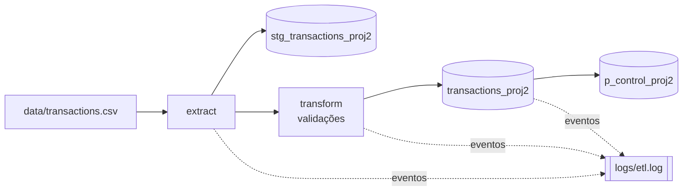

# Projeto 2 — ETL Estruturado com Staging, Logging e Tabela de Controlo

Evolução do [Projeto 1](../PROJETO1). O pipeline continua a ler transações bancárias de um CSV e a carregá-las em PostgreSQL, mas passa a ter a estrutura de um processo ETL real: **tabela de staging**, **validação de dados**, **logging em ficheiro** e uma **tabela de controlo** que regista o resultado de cada execução (sucesso ou erro).

## Arquitetura



Fluxo em `main.py`:

1. **Extract** — lê o CSV para um `DataFrame`.
2. **Load staging** — guarda os dados tal como chegaram em `stg_transactions_proj2`.
3. **Transform** — aplica as regras de validação.
4. **Load target** — carrega os registos válidos em `transactions_proj2`.
5. **Controlo** — insere em `p_control_proj2` uma linha com o número de registos lidos, carregados e o estado (`SUCCESS`/`ERROR`).

Se qualquer passo falhar, o erro é escrito no log, a execução fica registada como `ERROR` na tabela de controlo (com a mensagem) e a exceção é relançada.

## Stack

| Componente | Utilização |
|---|---|
| Python 3 | Linguagem do pipeline |
| Pandas | Leitura e validação dos dados |
| SQLAlchemy | Ligação, `to_sql` e inserts parametrizados |
| psycopg2 | Driver PostgreSQL |
| PostgreSQL | Staging, destino e controlo |
| `logging` (stdlib) | Registo de eventos em ficheiro |

## Estrutura

```
PROJETO2/
├── main.py                # Orquestração do pipeline e tratamento de erros
├── config.py              # Parâmetros de ligação à base de dados
├── data/
│   └── transactions.csv   # Dados de entrada
├── sql/
│   └── create_tables.sql  # DDL: staging, destino e controlo
├── logs/
│   └── etl.log            # Ficheiro de log gerado pelo pipeline
└── src/
    ├── extract.py         # Leitura do CSV
    ├── transform.py       # Regras de validação
    ├── load.py            # Carga em staging e destino (get_engine)
    ├── p_control.py       # Registo de execuções na tabela de controlo
    └── log.py             # Configuração do logger
```

## Regras de validação

Em `src/transform.py`, só passam para a tabela de destino os registos que cumprem **ambas** as regras:

1. `amount > 0`
2. `transaction_type` ∈ {`DEPOSIT`, `WITHDRAWAL`}

Com os dados de exemplo, a staging recebe 4 registos e o destino 3.

## Modelo de dados

| Tabela | Função |
|---|---|
| `stg_transactions_proj2` | Cópia dos dados originais, antes de qualquer validação |
| `transactions_proj2` | Dados validados |
| `p_control_proj2` | Uma linha por execução do pipeline |

Estrutura da tabela de controlo:

| Coluna | Tipo | Descrição |
|---|---|---|
| `process_name` | `VARCHAR(100)` | Nome do processo (`DAILY_ETL`) |
| `execution_date` | `TIMESTAMP` | Data/hora da execução |
| `rows_read` | `INTEGER` | Registos lidos do CSV |
| `rows_loaded` | `INTEGER` | Registos carregados no destino |
| `status` | `VARCHAR(20)` | `SUCCESS` ou `ERROR` |
| `error_message` | `VARCHAR(500)` | Mensagem de erro (se existir) |

O DDL completo está em `sql/create_tables.sql`.

## Logging

O logger (`src/log.py`) escreve em `logs/etl.log` ao nível `INFO`, no formato `data - NÍVEL - mensagem`. Exemplo de uma execução com sucesso:

```
2026-06-25 17:26:26,172 - INFO - Início do ETL
2026-06-25 17:26:26,172 - INFO - A ler CSV
2026-06-25 17:26:26,173 - INFO - A carregar dados para STG_TRANSACTIONS_PROJ2
2026-06-25 17:26:26,352 - INFO - 4 registos carregados na tabela staging
2026-06-25 17:26:26,353 - INFO - A validar dados
2026-06-25 17:26:26,361 - INFO - A carregar dados para TRANSACTIONS_PROJ2
2026-06-25 17:26:26,423 - INFO - 3 registos carregados na tabela target
2026-06-25 17:26:26,455 - INFO - ETL concluído com sucesso!
```

## Como executar

**Pré-requisitos:** Python 3 e um servidor PostgreSQL acessível.

1. Criar a base de dados e as tabelas:

   ```bash
   psql -U postgres -c 'CREATE DATABASE "bankingDW";'
   psql -U postgres -d bankingDW -f sql/create_tables.sql
   ```

2. Ajustar `config.py` com os dados da tua ligação (`DB_USER`, `DB_PASSWORD`, `DB_HOST`, `DB_PORT`, `DB_NAME`).

3. Instalar as dependências:

   ```bash
   pip install pandas sqlalchemy psycopg2-binary
   ```

4. Executar a partir da pasta do projeto (os caminhos do CSV e do log são relativos e a pasta `logs/` tem de existir):

   ```bash
   cd PROJETO2
   python main.py
   ```

Para consultar o resultado e o histórico de execuções:

```sql
SELECT * FROM transactions_proj2;

SELECT process_name, execution_date, rows_read, rows_loaded, status, error_message
FROM p_control_proj2
ORDER BY execution_date DESC;
```

## Limitações conhecidas

- **Tabelas recriadas em cada execução:** `load_stg` e `load_target` usam `if_exists="replace"`, que apaga e recria as tabelas. Isto evita duplicados, mas perde histórico e faz com que os tipos das colunas sejam inferidos pelo Pandas em vez de seguirem o DDL.
- **Datas como texto:** ao contrário do Projeto 1, `transaction_date` não é convertida para `datetime` antes da carga.
- **Rejeições não guardadas:** os registos que falham a validação são descartados. Só se sabe quantos foram (`rows_read - rows_loaded`), não quais.
- **Controlo de erros:** em caso de falha, `rows_read` e `rows_loaded` ficam a 0 na tabela de controlo.
- **Credenciais no código:** ficam em `config.py`.

## Próximos passos possíveis

- Carga incremental com `MERGE`/`INSERT ... ON CONFLICT` e chave primária em `transaction_id`.
- Tabela de rejeições com o motivo de cada registo descartado.
- Ler credenciais de variáveis de ambiente.

## O que aprendi

- Separar **staging** e **destino** para preservar os dados originais.
- Registar execuções numa **tabela de controlo** e tratar erros de forma explícita.
- Configurar `logging` com ficheiro, níveis e formato.
- Usar queries parametrizadas com SQLAlchemy (`text()` + dicionário de parâmetros).
- Partilhar a criação do `engine` entre módulos.
