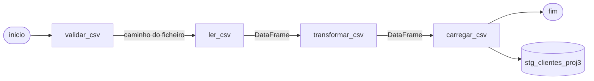

# Projeto 3 — Orquestração de Pipelines com Apache Airflow

Terceiro projeto da série. Em vez de correr o ETL com `python main.py`, o pipeline passa a ser um **DAG do Apache Airflow**: cada fase é uma *task* independente, com ordem de execução definida, estado visível numa interface web e dados passados entre tasks por **XCom**. Toda a infraestrutura corre em **Docker Compose** com `CeleryExecutor`, **Redis** como *broker* e **PostgreSQL**.

## Arquitetura



As setas com etiqueta representam valores passados por XCom entre tasks.

### Serviços Docker

| Serviço | Função | Porta no host |
|---|---|---|
| `postgres` | Base de dados de metadados do Airflow (PostgreSQL 17) | `5433` |
| `redis` | *Broker* do Celery (Redis 7.2) | — |
| `airflow-apiserver` | API e interface web | `8080` |
| `airflow-scheduler` | Agenda e despacha as tasks | — |
| `airflow-dag-processor` | Lê e processa os ficheiros de DAGs | — |
| `airflow-worker` | Executa as tasks (Celery) | — |
| `airflow-triggerer` | Suporte a tasks diferidas | — |
| `airflow-init` | Inicialização: migração da BD e criação do utilizador | — |
| `flower` | Monitorização do Celery (opcional, perfil `flower`) | `5555` |

O `docker-compose.yml` parte do exemplo oficial do Airflow (imagem `apache/airflow:3.0.2`) e instala `pandas`, `sqlalchemy` e `psycopg2-binary` no arranque através de `_PIP_ADDITIONAL_REQUIREMENTS`.

## Stack

| Componente | Utilização |
|---|---|
| Apache Airflow 3.0.2 | Orquestração |
| CeleryExecutor + Redis | Execução distribuída das tasks |
| PostgreSQL 17 | Metadados do Airflow e destino dos dados |
| Docker / Docker Compose | Ambiente reproduzível |
| Python, Pandas, SQLAlchemy | Lógica do ETL |

## O DAG

`dags/teste_dag.py` define o DAG `clientes_dag`:

- **Agendamento:** `schedule=None` (execução manual).
- **Catchup:** desativado.
- **Tags:** `Projeto3`, `ETL`.

| Task | Função | O que faz | Passa por XCom |
|---|---|---|---|
| `inicio` | `EmptyOperator` | Marca o início | — |
| `validar_csv` | `validar_csv()` | Verifica que `/opt/airflow/data/clientes.csv` existe e não está vazio | Caminho do ficheiro |
| `ler_csv` | `ler_csv()` | Lê o CSV para um `DataFrame` | `DataFrame` |
| `transformar_csv` | `transformar_csv()` | Filtra os clientes da cidade **Porto** | `DataFrame` |
| `carregar_csv` | `carregar_csv()` | Carrega na tabela `stg_clientes_proj3` (modo `append`) | Número de registos |
| `fim` | `EmptyOperator` | Marca o fim | — |

Ordem: `inicio >> validar_csv >> ler_csv >> transformar_csv >> carregar_csv >> fim`.

## Dados

`data/clientes.csv`:

```csv
id,nome,idade,cidade
1,Ana,28,Porto
2,Bruno,35,Lisboa
3,Carlos,41,Porto
4,Diana,22,Braga
5,Eva,31,Coimbra
```

Depois do filtro por `cidade == "Porto"`, são carregados 2 registos (Ana e Carlos).

## Estrutura

```
PROJETO3/
├── docker-compose.yml     # Airflow (Celery) + PostgreSQL + Redis
├── .env                   # AIRFLOW_UID e AIRFLOW_PROJ_DIR
├── config/
│   └── airflow.cfg        # Configuração do Airflow
├── dags/
│   └── teste_dag.py       # Definição do DAG clientes_dag
├── data/
│   └── clientes.csv       # Dados de entrada
└── src/
    ├── validation.py      # Validação do ficheiro de entrada
    ├── extract.py         # Leitura do CSV
    ├── transform.py       # Filtro por cidade
    ├── load.py            # Carga na tabela de staging
    ├── database.py        # Criação do engine SQLAlchemy
    └── config.py          # Parâmetros de ligação à base de dados
```

As pastas `dags`, `logs`, `config`, `plugins`, `data` e `src` são montadas como volumes em `/opt/airflow/` e o `PYTHONPATH` aponta para `/opt/airflow`, por isso o DAG consegue fazer `from src.extract import ler_csv`.

## Como executar

**Pré-requisitos:** Docker e Docker Compose. O Airflow recomenda pelo menos 4 GB de memória e 2 CPUs disponíveis para o Docker.

1. Entrar na pasta do projeto:

   ```bash
   cd PROJETO3
   ```

2. Inicializar a base de dados do Airflow e criar o utilizador:

   ```bash
   docker compose up airflow-init
   ```

3. Arrancar todos os serviços:

   ```bash
   docker compose up -d
   ```

4. Abrir a interface em <http://localhost:8080> e iniciar sessão com o utilizador por omissão do compose: `airflow` / `airflow`.

5. Os DAGs são criados em pausa (`DAGS_ARE_PAUSED_AT_CREATION`). Ativar o `clientes_dag` e carregar em **Trigger** para o executar.

6. Acompanhar a execução task a task na vista *Grid/Graph* e consultar os logs de cada uma.

Para parar o ambiente:

```bash
docker compose down        # mantém os dados do PostgreSQL
docker compose down -v     # apaga também o volume de dados
```

Para ativar a monitorização do Celery (Flower, em <http://localhost:5555>):

```bash
docker compose --profile flower up -d
```

### Base de dados de destino

A task `carregar_csv` liga-se à base de dados definida em `src/config.py` (`DB_USER`, `DB_PASSWORD`, `DB_HOST`, `DB_PORT`, `DB_NAME`). O host `postgres` é o nome do serviço dentro da rede do Docker Compose. Esse serviço cria, por omissão, o utilizador e a base `airflow`, por isso é preciso garantir que os valores de `config.py` correspondem a uma base e a um utilizador que existam nesse servidor (ou ajustar o `config.py`, ou criar a base e o utilizador em falta).

## Notas de desenho

- **XCom para passar `DataFrame`s** serve bem para este volume de dados. Com dados maiores, o habitual é passar apenas referências (caminhos, nomes de tabelas) e deixar os dados em ficheiros ou numa tabela de staging.
- **`_PIP_ADDITIONAL_REQUIREMENTS`** instala as dependências a cada arranque dos contentores. É prático para desenvolvimento, mas o recomendado é construir uma imagem própria.
- **Exemplos do Airflow** ficam ativos (`LOAD_EXAMPLES: "true"`), por isso aparecem DAGs de demonstração ao lado do `clientes_dag`.
- Este ambiente destina-se a **desenvolvimento local**, não a produção.

## Limitações conhecidas

- **Credenciais no código:** `src/config.py` tem a palavra-passe escrita diretamente. O mais indicado é usar variáveis de ambiente ou as *Connections* do Airflow.
- **Carga com `append`:** executar o DAG várias vezes acrescenta os mesmos registos de novo.
- **Sem agendamento:** o DAG só corre quando é acionado manualmente.
- **Sem tratamento de rejeições nem logging próprio:** as mensagens vêm dos `print` e dos logs das tasks.

## O que aprendi

- Modelar um pipeline como **DAG** com dependências entre tasks.
- Usar `PythonOperator` e **XCom** para passar dados entre tasks.
- Subir um cluster Airflow com **Docker Compose**, `CeleryExecutor`, **Redis** e **PostgreSQL**.
- Perceber o papel de cada componente: apiserver, scheduler, dag-processor, worker e triggerer.
- Montar código partilhado (`src/`) como volume e importá-lo dentro dos DAGs.
